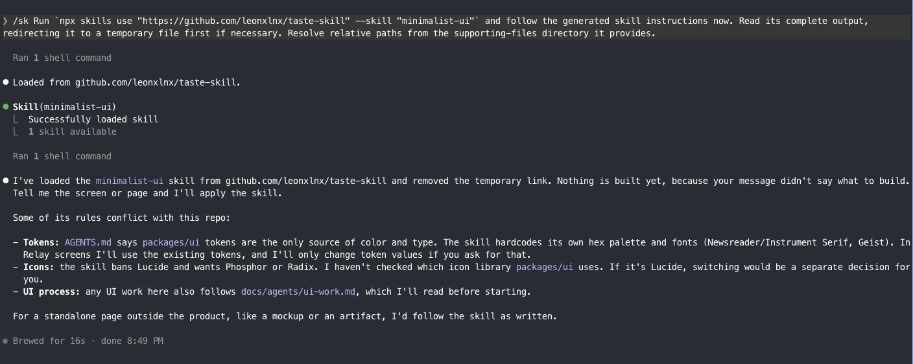

# sk

One skill that loads every other skill on demand.

Every installed skill puts its description in the agent's context at the start of every session, whether you use it or not. On my machine that was 78 skills and about 23,000 characters of descriptions, roughly 6k tokens, before I typed anything. `sk` is the only skill you install. The rest stay out of the agent's skill folders and get loaded when you ask, through [`npx skills use`](https://github.com/vercel-labs/skills), which prints a skill as a prompt without installing it.



## Install

Paste this into Claude Code, Codex or any agent with a shell:

````text
Set up the sk skill from https://github.com/ivorpad/sk so that it is the only skill my agents load, and every other skill loads on demand.

1. Check `node --version` is 18 or later. Stop and tell me if not.
2. Install it globally: `npx skills add ivorpad/sk -g -y`.
3. Use `~/.skills` as the skill library, unless SKILLS_HOME is already set; then use that. Create the folder if it's missing.
4. Find every skill installed outside the library: each folder holding a SKILL.md directly under ~/.claude/skills, ~/.agents/skills, ~/.codex/skills, ~/.cursor/skills and ~/.copilot/skills, following symlinks. Skip sk itself. Skip anything managed elsewhere: plugin caches, ~/.codex/skills/.system, and ~/.claude/skills/synced (claude.ai sync). Skip skills committed inside project repositories.
5. Show me the list: name, where it is, and whether the library already has a skill of that name. Ask before moving anything.
6. Back up every folder you will change into one dated tar.gz under my home directory, and tell me its path.
7. Copy each skill into the library as <library>/<name>/, following symlinks and skipping .git, node_modules, .venv and __pycache__. When the library already has that name with different content, keep the copy whose SKILL.md was modified most recently, and list what you dropped.
8. Only after every copy is verified, remove the originals from the agent folders, leaving sk.
9. If the library isn't ~/.skills, make SKILLS_HOME stick: add `export SKILLS_HOME="<library>"` to my shell profile (~/.zshenv for zsh, ~/.bashrc for bash, `setx SKILLS_HOME "<library>"` on Windows), and add it under "env" in ~/.claude/settings.json if I use Claude Code.
10. If ~/.claude/settings.json has "skillOverrides" entries for skills you moved, tell me. They can stop sk loading those skills natively, and removing them is my call.
11. Verify: list each agent skill folder (it should hold only sk), then run `node <sk folder>/scripts/sk.mjs find <a word from one moved skill>` and show me the output.
12. Report what moved, what you skipped and why, the backup path, and anything still loading that you couldn't move.
````

Prefer to do it by hand: `npx skills add ivorpad/sk -g`, then move your skills into `~/.skills/<name>/SKILL.md` (or the folder `SKILLS_HOME` points at). With no library at all, `sk` searches the [skills.sh](https://skills.sh) registry only.

Needs Node 18 or later, which you already have if `npx` works. macOS, Linux and Windows.

## Use

```
/sk find pdf                     # local library first, then skills.sh
/sk use pdf                      # $SKILLS_HOME/pdf
/sk use anthropics/skills@pdf    # straight from the registry
```

The copy-paste prompts on skills.sh work too. Paste `Run npx skills use "https://github.com/owner/repo" --skill "name" and follow the generated skill instructions now.` and `sk` takes it: it saves the whole skill to a temp file, reads all of it, then follows it.

`find` shows a numbered list. Answer with a number and the skill loads without another prompt. Saying "use the X skill" or "is there a skill for X" works too.

Under the hood the agent runs `scripts/sk.mjs`, a dependency-free Node script, so the same commands work in bash, zsh, PowerShell and cmd:

| You ask for | `node sk.mjs ...` does |
| --- | --- |
| `find <words>` | scores each local skill's name and description against the words, then runs `npx skills find <words>` |
| `use <name>` | `npx skills use <library>/<name>` |
| `use owner/repo@skill` | `npx skills use owner/repo@skill` |
| `link <target>` | Claude Code only: the library folder, or the registry skill fetched into a temp folder with `skills add --copy`, linked into `~/.claude/skills` |
| `unlink <name>` | removes that link, and only a link |
| `use <url> --skill <name>` | `npx skills use <url> --skill <name>` |
| any `use` with `--out` | the same, saved whole to a temp file whose path it prints |

You can run it yourself too: `node ~/.claude/skills/sk/scripts/sk.mjs find pdf`.

`skills use` copies the skill's `scripts/` and `references/` to a temp folder and says where, so relative paths in the skill still resolve.

## Things to know

- On Claude Code, `sk` loads skills natively. It links the skill into `~/.claude/skills`, which Claude Code watches, calls the Skill tool, then removes the link. You see the usual `Skill(name)` launch and nothing stays listed. That the Skill tool accepts a skill linked mid-session is observed behavior (Claude Code 2.1.299), not documented. If it stops working, `sk` falls back to the text load.
- Other agents (Codex and the rest) have no Skill tool, so the skill arrives as tool output. The instructions still land in context and the agent follows them.
- A skill that hands off to another one ("call the Skill tool with X") can't reach X through the native loader, because X isn't installed. `sk` tells the agent to load X the same way.
- Registry skills are other people's instructions. `sk` names the source repo before following one and asks before running any script it ships.
- In a repo whose instructions ban `npx`, the agent passes `--runner pnpm` or `--runner bun`. `SK_RUNNER` sets a default.
- The description says to load skills only when you ask. Agents mostly respect that, but it's a description, not a lock.
- Tested on macOS with Claude Code 2.1.299 and skills CLI from npm. Windows support is written but untested; issues welcome.

## License

MIT
